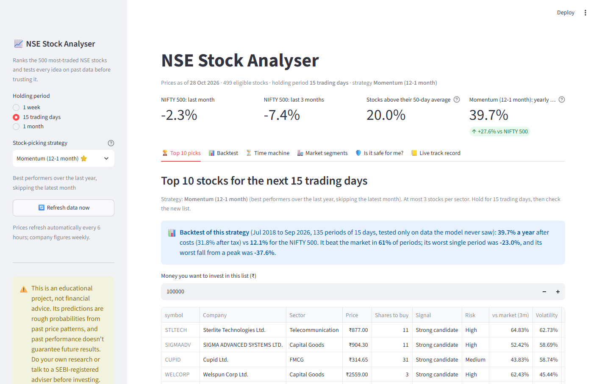

# NSE Stock Analyser

A Streamlit app that picks a **top-10 list of NSE stocks for the next 15 days** and checks
every idea against history before trusting it. Strategies are compared on a walk-forward
backtest after trading costs and tax. A "time machine" replays any past date, and a live
track record scores each list once its outcome is known.

> **Not financial advice.** Educational project. The research notes show how limited
> short-term prediction is.

📄 **[Research notes: method, every experiment, results](RESEARCH.md)**



## Headline results (15-day holding, Jul 2018 to Sep 2026, after costs)

| Strategy | Yearly return | Range across start days | Sharpe | IC |
|---|---|---|---|---|
| ML model (gradient boosting ranker) | 16.8% | 11.2% to 29.0% | 0.50 | 0.034 (t = 2.8) |
| Momentum (12-1 month) | 39.7% | 34.4% to 41.2% | 1.02 | 0.045 |
| Average stock (equal weight) | 21.5% | 21.3% to 22.9% | 0.68 | |
| NIFTY 500 (with estimated dividends) | 12.1% | 11.8% to 12.6% | 0.38 | |

**Treat these as upper limits, not expected returns.** The range shows the same test started on
each of the 15 possible days of the cycle.

- **The ML signal is statistically real but unreliable.** Its return depends heavily on the start
  day, and its typical result (18.5%) is below the average stock (22.0%).
- **Momentum came first on all 15 start days, but survivorship bias inflates it.** Every stock
  tested is on today's NSE list, so companies that collapsed or shrank off it are missing. On
  only the 100 most-traded stocks each day, momentum falls to 21.8% and the average stock to
  13.8%.

Details and caveats are in [RESEARCH.md](RESEARCH.md).

## Features

| Tab | What it does |
|---|---|
| 🏆 **Top 10 picks** | Today's 10 picks (max 3 per sector) for a 1-week, 15-day or 1-month hold, with shares to buy for your budget, risk level and company-quality checks |
| 📊 **Backtest** | 5 strategies vs 2 benchmarks: CAGR, after-tax CAGR, Sharpe, drawdown, hit rate, turnover, IC, and a growth chart |
| ⏳ **Time machine** | Go back to any date, train only on what was known then, pick 10 stocks for 7 days / 1 month / 6 months / 1 year, and compare with what actually happened, for one date or every quarter |
| 🏭 **Market segments** | Sector strength, breadth and momentum |
| 🛡️ **Is it safe for me?** | Risk level, position-size limit, rupee loss in a bad month, warning signs, chart and news for any stock |
| 📒 **Live track record** | Every strategy's list is saved daily, for every holding period, and later scored vs the NIFTY 500 |

## How it works

1. **Universe:** the 755 stocks on today's NSE Total Market list, of which 714 have enough price
   history. On each date only the 500 most-traded *at that time* are eligible. This doesn't remove
   survivorship bias, because every candidate is a company that made it onto today's list.
2. **Features:** 17 per-stock signals ranked within each day, plus 7 market-regime signals
   (India VIX, market trend, breadth).
3. **Model:** a gradient-boosting regressor predicting each stock's rank for the next 15 days.
4. **Validation:** walk-forward with a purge gap, so the model never trains on answers it
   couldn't have known. Unit tests check this.
5. **Simulation:** signals use finished trading days only, buy the day after the signal, 0.4%
   round-trip costs, 20% STCG tax, hold buffer to cut turnover. The NIFTY 500 gets an estimated
   1% a year of dividends, because stock prices include them and the index level doesn't.

All assumptions live in [`stock_predictor/config.py`](stock_predictor/config.py).

## Run it

```bash
python -m venv .venv
.venv\Scripts\activate          # Windows  (macOS/Linux: source .venv/bin/activate)
pip install -r requirements.txt
streamlit run app.py
```

In VS Code, press **F5** → **Run dashboard (Streamlit)**. The first run downloads 10 years of
prices for about 755 stocks and trains the models, which takes a few minutes; after that,
results are cached in `data/` for the day.

### Tests

```bash
pip install -r requirements-dev.txt
pytest
```

The tests use a synthetic market (no internet). They check that features never use future
prices, that walk-forward training and the time machine never see unknown answers, that a
"perfect foresight" score wins and a random one doesn't, that unfinished trading days are left
out, and that costs, position sizing and the track record are correct.

## Project structure

```
app.py                       Streamlit dashboard
stock_predictor/
  config.py                  every assumption: horizon, costs, tax, universe size
  universe.py                NSE stock list + point-in-time "most traded" filter
  data.py                    prices, India VIX and fundamentals (Yahoo Finance), cached
  features.py                features, regime signals and forward-return targets
  model.py                   gradient-boosting ranker + walk-forward training
  backtest.py                top-10 portfolio simulation, strategies, metrics
  time_machine.py            replay a past date and compare with reality
  tracker.py                 live track record
  analysis.py                risk, sectors, fundamentals checks, safety verdict
  news.py                    news headlines + simple sentiment
  pipeline.py                ties everything together, with caching
tests/                       pytest suite (synthetic data)
track_record/picks.csv       saved picks (commit this to keep the live record)
RESEARCH.md                  method, experiments, results, limitations
```

## More projects

**Hybrid RAG** (in progress, not published yet): retrieval-augmented generation that combines
BM25 and dense search, reranks with a cross-encoder, and checks every citation against the
source text.

## License

[MIT](LICENSE)
